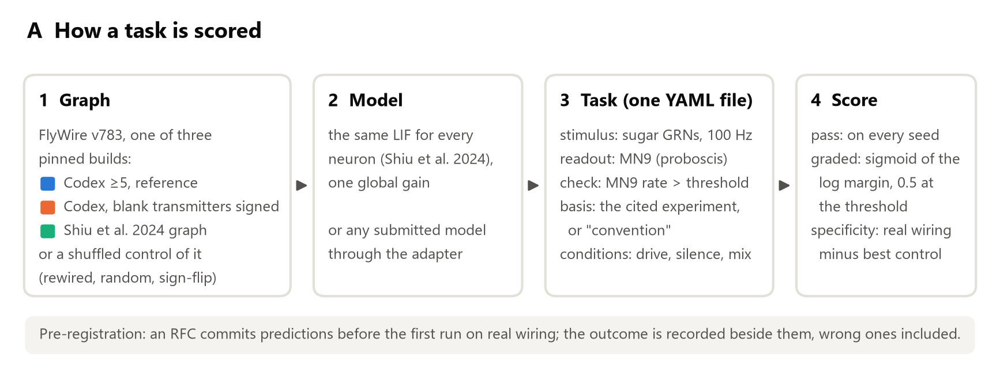
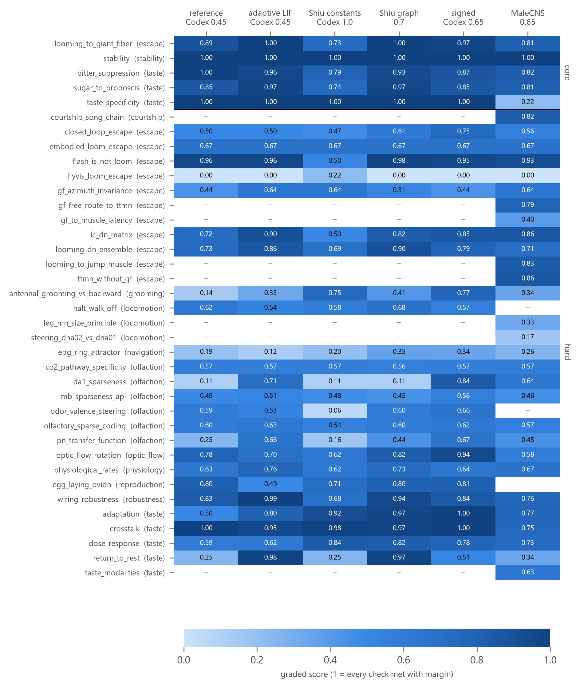
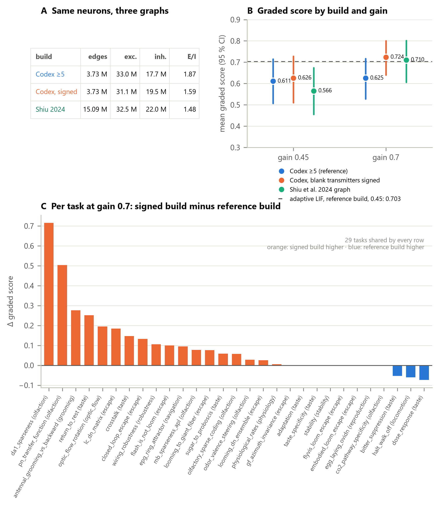
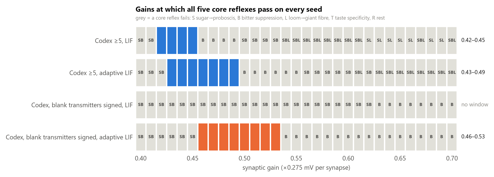
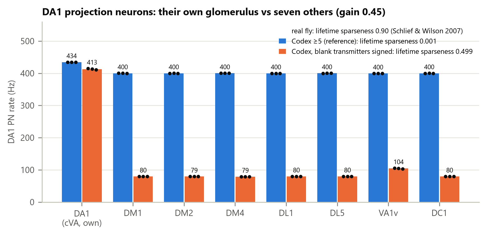
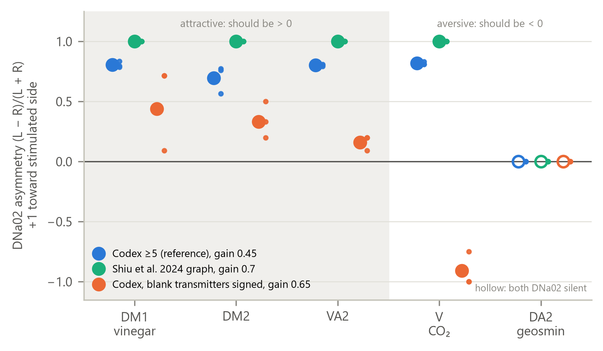
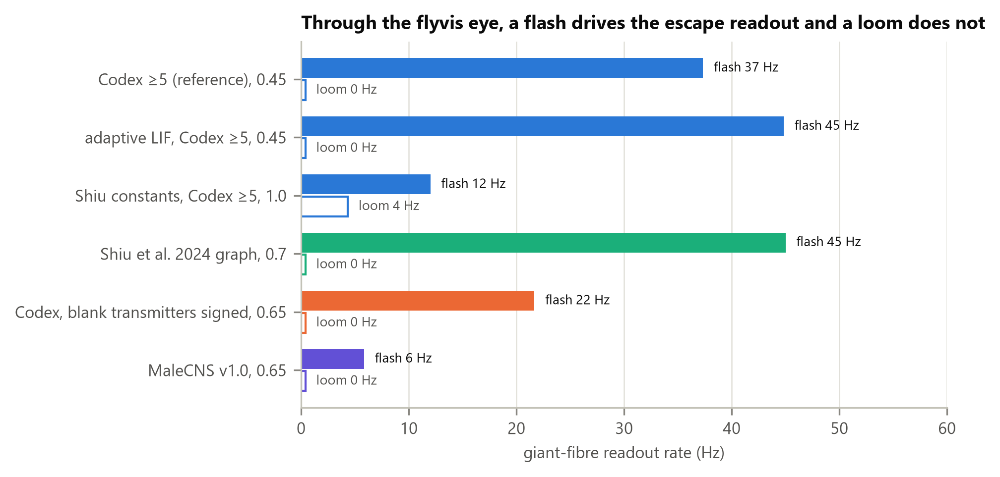

# Which build of the connectome a whole-brain fly model runs on changes what it can do

Brandon Cho, independent researcher

## Abstract

Whole-brain spiking models of *Drosophila* are built from "the FlyWire connectome", but that is not
one graph: synapse tables are re-predicted, edges thresholded, and each neuron's transmitter, which
fixes the sign of everything it does, is inferred, and left blank where the inference is weak. We
built flybench, a benchmark of {{facts.n_tasks}} tasks drawn from published fly experiments, scored
against shuffled-wiring controls, with predictions committed before the first run for every task and
model change after the first {{table_s1.n_before_rfcs}}. We used it to compare three builds of the same
{{facts.pins.flywire783.n|,}} neurons under the widely used leaky integrate-and-fire (LIF) model of
Shiu et al. (2024). At the gain where Shiu et al.'s graph passes its core reflexes, the build changes
the mean task score by as much as adding spike-frequency adaptation to the neuron model does
({{stats.pairs.ntfix07-ref07.diff|+.3f}}, 95 % CI {{stats.pairs.ntfix07-ref07.ci.0|+.3f}} to
{{stats.pairs.ntfix07-ref07.ci.1|+.3f}}, against {{stats.pairs.adaptive045-ref045.diff|+.3f}}); at the
reference model's own gain the builds do not differ detectably. Signing the
{{graphfacts.blank_nt_neurons|,}} neurons whose transmitter the public release leaves blank, with every
edge unchanged, scores about as high as Shiu et al.'s graph. It restores part of the antennal lobe's
channel identity, and at gains 0.5–0.65 it is the only change under which a model steers away from
CO₂ while still steering toward attractive odours. It also moves the working gain: on the signed
build no gain lets the LIF pass all five core feeding and escape reflexes, while an adaptive LIF
passes them from {{fig3_gain_windows.flywire783_ntfix_adaptive.window_text}}, against
{{fig3_gain_windows.flywire783_adaptive.window_text}} on the reference build. One failure is shared by
every build: driven through a connectome-constrained model of the eye, the escape pathway responds to
a flash and not to a looming object. An independent analysis with a different signing rule reproduced
the graph statistics and the loss of bitter suppression. Benchmarks of connectome models should state
which graph they ran on.

## 1. Introduction

Whole-brain models of *Drosophila* built directly from the FlyWire connectome (Dorkenwald et al.
2024) now drive simulated feeding, grooming and escape, and the leaky integrate-and-fire (LIF) model
of Shiu et al. (2024) has become a common starting point: its constants are reused, its gain retuned,
and its output wired to virtual bodies. Connectome-constrained models of the fly now span scales:
point-neuron models of the central brain driven by sensory input (Shiu et al. 2024), analyses of how
far the wiring constrains the network's dynamics (Pospisil et al. 2024), models of the visual system
constrained by the connectome or by behaviour (Lappalainen et al. 2024; Cowley et al. 2024), and
physics models of the body that such networks can drive (Wang-Chen et al. 2024; Vaxenburg et al.
2025). Benchmarks that score models against many measurements at once are established for primate
vision (Schrimpf et al. 2020). Whole-brain fly models are usually evaluated on a few behaviours chosen
by their authors, rarely against a control that destroys the wiring, and often without saying exactly
which graph they ran on.

"The FlyWire connectome" is not one graph. Synapses are detected automatically from the electron
micrographs (Buhmann et al. 2021), neurons are proofread and typed (Dorkenwald et al. 2024; Schlegel
et al. 2024), and the transmitter of each neuron, which fixes the sign of everything it does, is
predicted from the images with a confidence that varies from cell to cell (Eckstein et al. 2024).
Downstream, model builders threshold edges and decide what to do with neurons whose prediction is
too weak to publish. The graph's large-scale statistics are well characterised (Lin et al. 2024);
how much these construction choices change a simulation's behaviour is not.

We built flybench, a benchmark of {{facts.n_tasks}} tasks drawn from published fly experiments,
scored against shuffled-wiring controls (Section 2), and used it to ask that question. Three builds
of the same {{facts.pins.flywire783.n|,}} FlyWire v783 neurons differ in their scores, at a gain where
all three can work, by about as much as adding spike-frequency adaptation does (Result 1); each has
its own working gain, and one has none (Result 2). Signing the neurons whose transmitter the public
release leaves blank restores part of the antennal lobe's channel identity (Result 3) and is the only
change that makes a model turn away from CO₂ (Result 4). One failure is shared by every build:
through a model of the fly's eye, the escape pathway responds to a flash and not to a looming object
(Result 5).

## 2. The benchmark

**Tasks.** Each of the {{facts.n_tasks}} tasks is a stimulus, a readout population and one or more
checks taken from a published experiment: sugar on the labellum extends the proboscis (MN9 fires);
bitter suppresses it; a looming object drives the giant fibre; the DA1 projection neurons respond to
their own odour and not to others; an attractive odour on one antenna biases the ipsilateral steering
neuron DNa02. A few tasks check physiology or stability rather than a behaviour (the network is
silent without input; rates stay in a physiological range). Every threshold names its source, a
published experiment whose DOI was checked against Crossref for author and year, or is marked as a
convention. {{facts.n_core}} tasks form the *core* tier, the feeding and escape reflexes the reference
model was tuned to pass; the other {{facts.n_hard}} are *hard*. The tasks span {{facts.n_circuits}}
circuits (Fig. 1; Table S1 lists every task and its sources).

**Pre-registration.** The first {{table_s1.n_before_rfcs}} tasks, including the five core reflexes,
were written before the proposal process existed and carry no pre-registered predictions. From task
{{table_s1.first_rfc_task}} on, every task, and every change to the scoring rules, the model or the
graph, starts as a written proposal (an RFC) with predictions for the reference model, an adaptive
LIF, the male connectome and the shuffled control, committed to the public repository before the
first run on real wiring. Outcomes are recorded next to the predictions, including the wrong ones
(Table 1); the experiments in this paper are covered by RFC D1 (the graph builds) and RFC 37 (odour
valence).

**Controls.** Each task can be scored on three destroyed versions of the same graph: degree-preserving
rewiring (each neuron keeps its out-degree, weights and sign; targets are shuffled; Maslov & Sneppen
2002), an Erdős–Rényi graph matched in size and weight distribution, and a sign permutation. A task
that also passes on shuffled wiring is flagged non-diagnostic; a row's *specificity* is the mean task
score on real wiring minus the best control. Every row in this paper carries the rewired control.

**Scoring.** A threshold check has a margin *m*, the log₁₀ ratio of the measured value to the
threshold, signed so that *m* > 0 passes, and a graded score 1/(1 + 10^(−2*m*)): 0.5 on the threshold,
0.91 at 3.2× on the passing side. A check that carries the recorded mean and spread of its
measurement scores 1/(1 + exp(2(|*z*| − 2))) and passes when |*z*| < 2. A task's graded score is the
mean over its checks, averaged over seeds. Two gates prevent vacuous passes: a comparison between
conditions fails if every compared readout is at its refractory ceiling (RFC S1) or below 2 Hz (RFC
S2). A check passes only if the seed mean and every seed pass. This paper summarises a row by the
plain mean of task graded scores over the tasks every compared row ran; flybench's leaderboard ranks
by the interquartile mean (IQM) over tasks (Agarwal et al. 2021), and we report both where they
disagree.

**The toy.** A {{facts.pins.toy.n|,}}-neuron synthetic network is hand-wired so that every task can
pass. It proves a task is passable and its checks computable; it says nothing about the fly.

**Figure 1. The benchmark.** **A,** How one task is scored, with task 02 (sugar → proboscis) as the
example. **B,** Graded score of every task on six rows: the reference model (LIF, Codex ≥5 build, gain
0.45), the adaptive LIF on the same build, Shiu et al.'s constants at gain 1.0 on the Codex build,
the LIF on Shiu et al.'s graph at 0.7, the LIF on the signed build at 0.65, and the male connectome
(MaleCNS v1.0) at 0.65; three seeds each. Tasks are grouped by circuit, core tier first. "–": the task
cannot run on that row. Tasks that read the nerve cord run only on the male connectome, which has
one; the lateralised olfactory tasks run only on FlyWire, because the male connectome's olfactory
receptor neurons carry no soma side.

## 3. Results

### Result 1: three builds of the same neurons

The public FlyWire release (Codex v783) lists synapses per neuron pair and neuropil, keeping pairs
with at least five synapses ({{graphfacts.codex_pairs|,}} pairs). Shiu et al. (2024) distributed their
own graph of the same neurons, `Connectivity_783.parquet`, with no threshold
({{graphfacts.shiu_edges|,}} edges; {{graphfacts.shiu_synapse_share_lt5|.0%}} of its synapses sit in pairs
of fewer than five) and from an earlier synapse table: on the {{graphfacts.shared_pairs|,}} pairs the two
share, Codex counts a median {{graphfacts.count_ratio_median|.2f}}× more synapses, and the sign agrees on
{{graphfacts.same_sign_share_shared|.1%}}. The third difference is the one this paper turns on: Codex
leaves the transmitter blank for {{graphfacts.blank_nt_neurons|,}} neurons whose prediction is
low-confidence, mostly optic-lobe and sensory cells ({{graphfacts.blank_visual_sensory|,}} of them
photoreceptors and other visual sensory neurons), and a build that reads a blank as excitatory, as
flybench's reference did, makes all of them excitatory. Signing each by the majority transmitter of
its own predicted synapses makes {{graphfacts.blank_signed_inhibitory|,}} of them inhibitory.

The three builds therefore carry about the same excitation and different inhibition (Fig. 2A:
E/I {{fig2_graph_builds.graph_stats.flywire783.e_over_i|.2f}} for the reference build,
{{fig2_graph_builds.graph_stats.flywire783_ntfix.e_over_i|.2f}} with the blanks signed,
{{fig2_graph_builds.graph_stats.flywire783_shiu.e_over_i|.2f}} for Shiu's graph). We compare them with the
same LIF at two gains: 0.45, the reference build's working gain, and 0.7, where Shiu's graph passes
its core reflexes. At 0.7 the mean graded score over the {{fig2_graph_builds.tasks_compared|len}} tasks
every row ran is {{fig2_graph_builds.mean_graded.flywire783@0.7|.3f}} on the reference build,
{{fig2_graph_builds.mean_graded.flywire783_ntfix@0.7|.3f}} with the blanks signed and
{{fig2_graph_builds.mean_graded.flywire783_shiu@0.7|.3f}} on Shiu's graph (Fig. 2B). Paired over tasks,
signing the blanks adds {{stats.pairs.ntfix07-ref07.diff|+.3f}} (95 % CI
{{stats.pairs.ntfix07-ref07.ci.0|+.3f}} to {{stats.pairs.ntfix07-ref07.ci.1|+.3f}};
{{stats.pairs.ntfix07-ref07.better}} tasks better, {{stats.pairs.ntfix07-ref07.worse}} worse) and Shiu's
graph adds {{stats.pairs.shiu07-ref07.diff|+.3f}} ({{stats.pairs.shiu07-ref07.ci.0|+.3f}} to
{{stats.pairs.shiu07-ref07.ci.1|+.3f}}). For scale, adding spike-frequency adaptation to the reference
model at its own gain adds {{stats.pairs.adaptive045-ref045.diff|+.3f}}
({{stats.pairs.adaptive045-ref045.ci.0|+.3f}} to {{stats.pairs.adaptive045-ref045.ci.1|+.3f}}). The signed
build and Shiu's graph cannot be told apart ({{stats.pairs.ntfix07-shiu07.diff|+.3f}},
{{stats.pairs.ntfix07-shiu07.ci.0|+.3f}} to {{stats.pairs.ntfix07-shiu07.ci.1|+.3f}}); their order depends
on the summary, since the IQM puts Shiu's graph ahead ({{stats.pairs.ntfix07-shiu07.iqm_diff|+.3f}}).

At 0.45 the builds do not differ detectably (signed {{stats.pairs.ntfix045-ref045.diff|+.3f}},
{{stats.pairs.ntfix045-ref045.ci.0|+.3f}} to {{stats.pairs.ntfix045-ref045.ci.1|+.3f}}; Shiu's graph
{{stats.pairs.shiu045-ref045.diff|+.3f}}, {{stats.pairs.shiu045-ref045.ci.0|+.3f}} to
{{stats.pairs.shiu045-ref045.ci.1|+.3f}}): at the reference build's own gain, Shiu's graph and the signed
build are under-driven (Result 2). The effect of the build is therefore conditional on the gain, which
is itself a property of the build. Where it appears, it is not uniform (Fig. 2C): it is largest in
olfaction and in returning to rest after a stimulus, and three tasks get worse: dose response,
halting and bitter suppression. The blank neurons carry only
{{graphfacts.blank_synapse_share|.1%}} of the graph's synapses, so the effect is not a matter of how many
synapses changed sign but of where they are.

An independent analysis (Daniel Culotta, independent researcher, Italy; analyses run by AI
assistants under his direction; unpublished, personal communication, 2026) built Shiu's graph from
the same files and obtained the same edge counts and sign agreement. Signing the blanks by FlyWire's
top per-neuron prediction instead (8,564 neurons inhibitory), he also found the reference LIF loses
bitter suppression at every gain, and that the adaptive LIF passes all five core reflexes from gain
0.45 to 0.55. He notes three caveats: that window rests on three grid points with three seeds each
and no confidence intervals; about half of the score gained off the core comes from olfactory tasks,
where the newly signed neurons are low-confidence antennal-lobe local neurons; and the adaptive model
was tested after the reference model was seen to fail. Result 2 repeats the test on our signing rule,
with a finer grid and the predictions written first.

**Figure 2. Three builds of the same FlyWire v783 neurons.** **A,** Edges, and synapses summed by the
sign of the presynaptic neuron, per build. **B,** Mean graded score of the LIF on each build at gains
0.45 and 0.7, over the {{fig2_graph_builds.tasks_compared|len}} tasks every row ran, three seeds each.
Bars: 95 % CI of each row's mean (bootstrap over tasks and seeds); differences between rows are
paired over tasks and their CIs are given in the text. Dashed line: the adaptive LIF on the reference
build at 0.45. **C,** Per-task change at gain 0.7, signed build minus reference build.

### Result 2: the working gain belongs to the graph

A whole-brain LIF has one free parameter that matters, the gain that scales every synapse, and
flybench fixes it per model as the *core window*: the gains at which the five core reflexes (rest,
sugar → proboscis, bitter suppression, loom → giant fibre, taste specificity) all pass on every seed.
We swept gain from 0.40 to 0.70 in steps of 0.01 on two builds with both neuron models, five seeds per
point (124 runs), with the predictions committed first (RFC D1).

With the blank transmitters signed, the LIF has no window
({{fig3_gain_windows.flywire783_ntfix_lif.n_passing}} of {{fig3_gain_windows.flywire783_ntfix_lif.n_gains}} gains
pass; Fig. 3). Below 0.63 the proboscis motor neuron MN9 does not respond to sugar on every seed; from
0.63 it does, but bitter no longer suppresses it. The two taste reflexes want opposite gains, and on
this build no gain gives both. A coarser sweep (steps of 0.05) had already found no window, against
our prediction of one at 0.55–0.60 (Table 1); the fine sweep's prediction, written after it, was that
none would appear at 0.01 resolution either. Adding spike-frequency adaptation opens a window of
{{fig3_gain_windows.flywire783_ntfix_adaptive.window_points}} points,
{{fig3_gain_windows.flywire783_ntfix_adaptive.window_text}} (predicted: at least 0.05 wide within
0.45–0.60), close to the 0.45–0.55 Daniel Culotta found with a different signing rule. Above it,
bitter suppression fails again.

On the reference build the LIF's window is {{fig3_gain_windows.flywire783_lif.window_text}}
({{fig3_gain_windows.flywire783_lif.window_points}} points, predicted ~0.42–0.47): flybench's reference gain of
0.45 sits on its upper edge, and one step above it bitter suppression fails. The adaptive LIF passes
from {{fig3_gain_windows.flywire783_adaptive.window_text}}, {{fig3_gain_windows.flywire783_adaptive.window_points}}
points, more than twice the width we predicted (at most 0.03): we had read a single passing point on
the coarse grid as a narrow window. Signing the blanks does not widen the adaptive window
({{fig3_gain_windows.flywire783_ntfix_adaptive.window_points}} points against
{{fig3_gain_windows.flywire783_adaptive.window_points}}); it shifts it up by about 0.03 and removes the LIF's.
Every row fails the same way at its edges: below a window, sugar does not reliably drive MN9; just
above, bitter no longer suppresses it. On the reference build, higher still, the whole brain ignites
and the sugar and loom checks fail too; on the signed build, nothing but bitter suppression fails from
there up to 0.70.

The working gain is therefore not a property of the neuron model alone. It moves with the transmitter
assignment of neurons no core task reads, and a gain tuned on one build carries no guarantee on
another. The core tier was defined by what the reference model passes, so these windows measure each
build against the reference's own reflexes; they compare builds, they do not rank them.

**Figure 3. The core window per build and neuron model.** Each cell is one gain (0.40–0.70, steps of
0.01) run on the five core tasks with five seeds. Filled: all five core reflexes pass on every seed.
Grey: at least one fails, lettered S (sugar → proboscis), B (bitter suppression), L (loom → giant
fibre), T (taste specificity) or R (rest). Right: the longest run of passing gains.

### Result 3: the antennal lobe's channels

DA1 projection neurons in the fly respond to their own odour, cVA, and little to others (lifetime
sparseness 0.90; Schlief & Wilson 2007). On the reference build at its working gain they fire at
{{fig4_antennal_lobe.flywire783.rates.cva|.0f}} Hz to their own glomerulus and at
{{fig4_antennal_lobe.flywire783.rates.dm1|.0f}} Hz to each of seven others: lifetime sparseness
{{fig4_antennal_lobe.flywire783.sparseness|.3f}} (Fig. 4). We had recorded this as "the antennal lobe
carries no channel identity". With the blank transmitters signed, the response to other glomeruli
falls to {{fig4_antennal_lobe.flywire783_ntfix.rates.dm1|.0f}} Hz while the own-channel response stays at
{{fig4_antennal_lobe.flywire783_ntfix.rates.cva|.0f}} Hz (sparseness
{{fig4_antennal_lobe.flywire783_ntfix.sparseness|.2f}}; {{fig4_antennal_lobe.flywire783_ntfix_0.65.sparseness|.2f}}
at gain 0.65). Neither adaptation nor Shiu's graph does this: the adaptive LIF on the reference build
reaches {{fig4_antennal_lobe.adaptive_reference_0.45.sparseness|.3f}}, and Shiu's graph at 0.7
{{fig4_antennal_lobe.shiu_graph_0.7.sparseness|.3f}}. Part of the earlier finding was therefore a property
of the build, not of the model; the rest stands, since
{{fig4_antennal_lobe.flywire783_ntfix.sparseness|.2f}} is still far from 0.90. The signed build has no gain
at which every core reflex passes (Result 2), so this is a statement about the antennal lobe on that
build, not about a model that passes the rest of the benchmark.

**Figure 4. DA1 projection neurons and their own channel (task 18).** DA1 PN rate when the receptor
neurons of one glomerulus are driven at 100 Hz, on the reference build and the signed build at gain
0.45. Bars: mean of three seeds; dots: each seed. DA1's own ligand is cVA. Legend: lifetime sparseness
across the eight conditions, against 0.90 measured in the fly (Schlief & Wilson 2007).

### Result 4: odour valence

Task 37 drives the receptor neurons of one glomerulus on the left antenna and reads the left and
right DNa02. In the fly, DM1, DM2 and VA2 are attractive and V (CO₂) and DA2 (geosmin) aversive.
On the reference build every channel drives the stimulated side harder, including CO₂
({{fig5_valence.flywire783_gain0.45.v.left_hz|.0f}} Hz left against
{{fig5_valence.flywire783_gain0.45.v.right_hz|.0f}} Hz right): the model would turn toward everything it
smells (Fig. 5). Shiu's graph does the same. With the blank transmitters signed, from gain 0.5 to 0.7
CO₂ on the left antenna drives the right DNa02 instead, on every seed (at 0.65,
{{fig5_valence.flywire783_ntfix_gain0.65.v.left_hz|.1f}} against
{{fig5_valence.flywire783_ntfix_gain0.65.v.right_hz|.0f}} Hz), and at 0.5, 0.6 and 0.65 every attractive
channel still biases the left: the only separation of an aversive from an attractive channel in any
row. It is not robust across gain: at 0.45 the signed build turns toward CO₂, and at 0.55 and 0.7 an
attractive channel fails (RFC 37). The rates are modest, the asymmetry of the attractive channels varies between seeds, and
the signed build fails bitter suppression at every one of these gains. We had predicted the
separation would not happen. Geosmin, carried by few receptor neurons, reaches DNa02 on no build.

**Figure 5. Odour valence (task 37).** The receptor neurons of one glomerulus on the left antenna are
driven at 100 Hz; the asymmetry (L − R)/(L + R) of the left and right DNa02 rates is +1 for a turn
toward the stimulated side and −1 for a turn away. Shaded: attractive channels (should be > 0);
unshaded: aversive (should be < 0). The reference build and Shiu's graph at their working gains; the
signed build, which has no gain passing every core reflex, at 0.65, the best of its gains on this
task. Large dots: from seed-mean rates; small dots: each seed. Hollow: both DNa02 below 2 Hz (no
response).

### Result 5: vision through a model of the eye

Task 32 renders a looming disc and a full-field flash through the flyvis model of the fly's optic
lobe (Lappalainen et al. 2024) and drives the connectome's own visual neurons column by column. On
every build and on the male connectome, the flash drives the giant-fibre readout (reference build
{{fig6_vision.flywire783_gain0.45.flash_hz|.0f}} Hz) and the loom drives nothing at the working gains, not
even the loom detectors LPLC2 and LC4 (Fig. 6); only Shiu et al.'s constants at gain 1.0 give the loom
a response ({{fig6_vision.shiu2024.loom_hz|.0f}} Hz), still below the flash
({{fig6_vision.shiu2024.flash_hz|.0f}} Hz). This failure does not depend on the build, and the account
recorded in RFC 32 suggests why. The loom reaches the driven T5 cells as a sparse late edge: even in
the last frame only 10–15 % of columns exceed 20 Hz, about 1 Hz averaged over the field, which is
roughly 0.07 mV onto an LPLC2 through its ~110 T5 synapses. The flash is a synchronous transient on
every column at once. With these inputs, a point neuron that sums its synapses has no way to prefer
the first over the second, whatever the signs. In the fly, LPLC2's loom selectivity comes from the
layer-specific radial arrangement of its T4/T5 inputs and from inhibition of inward motion through
lobula-plate interneurons (Klapoetke et al. 2017), both of which depend on where on the dendrite each
input lands, which a point neuron pooling every synapse into one compartment discards. An alternative
we have not tested is the interface itself: flyvis outputs are converted to Poisson rates on the
connectome's cells, and a different mapping could change the loom's drive. The reflex tasks that drive
LPLC2 and LC4 themselves at 150 Hz were doing all the work of loom detection. The account was first
drawn from development runs before the RFC's outcome was recorded, so it is an explanation, not a
pre-registered prediction.

**Figure 6. Through a model of the eye, a flash drives the escape readout and a loom does not (task
32).** A looming disc and a full-field flash are rendered through the flyvis optic-lobe model
(Lappalainen et al. 2024), whose outputs drive the connectome's own visual neurons column by column.
Bars: giant-fibre readout rate in the task window, mean of three seeds, for each build, Shiu et al.'s
constants at gain 1.0 and the male connectome. The loom gives 0 Hz on every seed of every row except
Shiu et al.'s constants; per-seed flash rates are not stored.

## 4. What this benchmark cannot tell you

**A pass is not a mechanism.** A task passes when a readout crosses a threshold taken from an
experiment. The model can cross it for a reason the fly does not have; several RFCs record a pass
"for the wrong reason" (Table 1). A failure is more informative than a pass, and specificity against
shuffled wiring is the minimum evidence that a pass depends on the connectome at all.

**Readouts are inferred.** Many tasks read a cell type as a stand-in for a behaviour: MN9 for
proboscis extension, the giant fibre for takeoff, the left/right DNa02 ratio for a turn. Task 37's
turn-away from CO₂ is a DNa02 asymmetry, not a turn; the CO₂ avoidance that flies show also runs
through the lateral horn and the mushroom body, which this readout does not test.

**Few seeds, threshold checks.** A check passes only if it passes on every one of three seeds (five
in the gain sweep). Near a threshold, outcomes are decided seed by seed, and a small change to a
stimulus can flip seeds in either direction (task 06 in flybench 1.0.1). The graded score is a
monotone transform of the margin to a threshold, not a likelihood; a mean over tasks weights every
task equally whatever its difficulty, and its value depends on the summary (mean or IQM).

**Not every task is pre-registered.** The first {{table_s1.n_before_rfcs}} tasks, the five core
reflexes among them, predate the proposal process, and the core tier was chosen as the reflexes the
reference model passes. Many thresholds are conventions, marked as such in the task files.

**The toy is not biology.** The {{facts.pins.toy.n|,}}-neuron toy is wired by hand so that every task
can pass; it shows a task is passable and computable, nothing about the fly.

**Datasets.** The male connectome lacks soma sides for the olfactory receptor neurons, so the
lateralised olfactory tasks run on FlyWire only. FlyWire's transmitter predictions have no histamine
class (Eckstein et al. 2024): of the {{photoreceptors.n_photoreceptors|,}} photoreceptors, which are
histaminergic and inhibitory in the fly (Hardie 1989), most are excitatory in every build
({{photoreceptors.excitatory_reference|,}} in the reference build,
{{photoreceptors.excitatory_after_signing|,}} with the blanks signed, {{photoreceptors.shiu_excitatory|,}} of
{{photoreceptors.shiu_with_outputs|,}} with outputs in Shiu's graph). No current task drives them (task 32
enters the connectome downstream, at T4/T5 and the transmedullary cells), but any task that does will
inherit the wrong sign.

**The reference build is kept, not fixed.** flybench 1.0 keeps the build that reads a blank
transmitter as excitatory as its reference, because the signed build has no gain at which all five
core reflexes pass (Result 2). Both builds are pinned and every result file names its graph; the
choice is documented, not hidden, and a later version can change it with a new reference row.

## 5. Predictions we got wrong

Of 27 pre-registered RFCs, about 85 of roughly 285 individual predictions (each scored check per
dataset, each predicted score, control score or named magnitude; counted by hand from the RFC outcome
sections) were wrong. Misses cluster in two assumptions: that a given gain makes the whole brain
ignite, and that the direct wiring between a stimulus and a readout decides the outcome. Table 1
lists the most informative. Every row is quoted from the outcome section of the named RFC, or from
`docs/FINDINGS.md`, in the repository.

**Table 1.** Selected wrong predictions. FW, FlyWire v783 reference build; MC, MaleCNS v1.0.

| RFC | predicted | measured | row | what it taught |
|---|---|---|---|---|
| 18 DA1 sparseness | sparseness 0.2–0.5 | 0.0009 | FW 0.45 | one glomerulus drove every PN; partly the blank-sign default (Result 3) |
| 19 GF → muscle | GF → TTMn 1.8–2.5 ms; legs before wings | 11.8 ms; wings 1.2 ms first | MC 0.65 | the missing gap junction is about one spike being enough, not about delay |
| 21 LC → DN matrix | LC16 → MDN excites (the surest positive) | 0 spikes | FW 0.45 | no direct or two-hop path exists; a functional result had been read as a synapse |
| 21 LC → DN matrix | 9/16, specificity −0.13 | 14/16, specificity +0.44 | MC 0.65 | a high gain is not "everything reaches everything" |
| 23 size principle | 0.95 of the pool recruited; shuffle ties | 0.47; shuffle 0.81 (specificity −0.33) | MC 0.65 | inhibition onto small motor neurons is size-structured; the shuffle destroys it |
| 24 optic flow | wrong-side DNp15 < 2 Hz | 51 Hz | FW 0.45 | one H2 cell lights 8.6 % of the brain |
| 25 grooming vs backward | 3/4 | 0/4 | FW 0.45 | network state (DSOG1 inhibition) beat a 4:1 two-hop wiring ratio |
| 28 DNa02 vs DNa01 | one DN ignites the CNS | 0.0 % active | MC 0.65 | a lone descending neuron on a silent cord moves nothing (led to the 2 Hz floor gate) |
| 29 EPG ring | bump in cue window, 3/7 | 1/7; MC ring 0 Hz in the dark | FW 0.45, MC 0.65 | one transmitter label (ExR6) produced opposite failures on the two datasets |
| 30 egg laying | oviEN → oviDN ≈ 0–2 Hz | 14.3 Hz | FW 0.45 | steady-state synapse arithmetic misses local recruitment |
| 35 GF-free route | silencing every DN abolishes TTMn | 3.17 spikes/neuron | MC 0.65 | point neurons fire ascending neurons backwards from axo-axonic input |
| M1 terminal synapses | no other task changes | 3 tasks improve (high salt: MN9 183 → 0 Hz) | MC 0.65 | the same artefact explained an unrelated taste failure |
| 37 odour valence | adaptive LIF 3/5 | 0/5 | adaptive 0.45 | adaptation made the DNa02 pair winner-take-all, decided by seed |
| D1 + 37 | signed build 3/5 ("signs fix inhibition, not valence") | 4/5; CO₂ turns away | signed 0.5–0.65 | the only aversive/attractive split on the board was hidden by a default (Result 4) |
| D1 graph | Shiu's graph adds ≤ +0.03 at gain 0.7 | +0.07 | Shiu 0.7 | construction matters as much as the neuron model (Result 1) |
| D1 sweep | signed build window 0.55–0.60 | no window | signed LIF | correct signs make the proboscis reflex switch-like (Result 2) |
| D1 fine sweep | adaptive window ≤ 0.03 wide | 0.43–0.49 | adaptive, Codex | one passing point on a coarse grid is not a narrow window |
| task 06 (FINDINGS) | adaptive LIF keeps the reflex at the measured 65 Hz | 0/3 seeds (26 → 2 Hz) | adaptive 0.45 | at the rate a real sugar receptor fires, the adaptive model's reflex does not conduct |

## Methods

**Model.** Every neuron is the same current-based LIF with Shiu et al.'s constants: resting and
reset potential {{facts.lif.v_rest_mv}} mV, threshold {{facts.lif.v_th_mv}} mV, membrane time constant
{{facts.lif.tau_m_ms}} ms, synaptic time constant {{facts.lif.tau_syn_ms}} ms, refractory period
{{facts.lif.t_ref_ms}} ms, synaptic delay {{facts.lif.delay_ms}} ms, {{facts.lif.w_syn_mv}} mV per synapse
scaled by a global gain, integration step {{facts.lif.dt_ms}} ms. The adaptive variant adds a
spike-triggered adaptation current (b = 2 mV, τ = 200 ms; Benda & Herz 2003).

**Stimuli and readouts.** As in Shiu et al. (2024), stimulated neurons are forced to spike as
independent Poisson processes at the task's rate (subject to refractoriness), from the task's start
to its end time; a ramp stimulus changes the rate linearly. Neurons are selected by FlyWire
annotations (cell type, class, side). A readout is the mean rate of its population in the task's
analysis window. Conditions run 0.5–2 s of simulated time (1 s or less for most tasks). Task 32's stimuli are the
flyvis model's per-column outputs, converted to Poisson rates on the matching connectome cells.

**Graphs.** All builds are pinned by a SHA-256 fingerprint over neuron ids, the sparse weight
matrix and annotations; a run refuses an unpinned graph. Reference build: the FlyWire Codex v783
download (codex.flywire.ai: filtered connections, transmitter predictions, annotations), synapses
summed across neuropils, pairs ≥ 5 kept, sign from the presynaptic neuron's transmitter (ACh,
dopamine, serotonin, octopamine excitatory; GABA, glutamate inhibitory; blank excitatory)
(`{{facts.pins.flywire783.sha256_short}}…`). Signed build: identical, except that a blank neuron takes the
synapse-weighted majority transmitter of its own rows in the Codex connection table
(`{{facts.pins.flywire783_ntfix.sha256_short}}…`). Shiu's graph: `Connectivity_783.parquet` from Shiu et al.'s
repository (github.com/philshiu/Drosophila_brain_model), with their signs, on the same neuron index,
annotations and positions (`{{facts.pins.flywire783_shiu.sha256_short}}…`). Male connectome: MaleCNS v1.0
from neuPrint (Janelia FlyEM 2025), same rules as the reference build.

**Controls.** The rewired control shuffles each neuron's targets while keeping its out-degree,
weights and signs (Maslov & Sneppen 2002), with a fixed seed; it is run with the same seeds and
stimuli as the real graph.

**Runs.** Three seeds per condition (seeds 0, 1, 2) with the rewired control, from flybench
{{facts.version}} (Zenodo, doi:{{facts.zenodo_version_doi}}). Each (task, wiring) unit is an independent
seeded simulation; parallel runs are bit-identical to serial ones. The gain sweep of Result 2 ran the
five core tasks only, five seeds per point, gains 0.40–0.70 in steps of 0.01; its result files and the
script that reads the windows (`scripts/core_window.py`) are in the repository
(`results/sweeps/d1_core_fine/`). Version 1.0.1 adds the sweep, the three-seed Codex row at gain 0.7
and task 06 rerun at the sugar-receptor rate its cited figure shows (65 Hz, not the 80 Hz of 1.0.0).
Each result file records the code version, parameters and graph fingerprint it ran with.

**Statistics.** Rows are compared over the tasks both ran. A paired difference is the mean over tasks
of the difference in task graded score; its 95 % CI comes from a hierarchical bootstrap (tasks
resampled with replacement, then each row's seeds resampled within each task; 10,000 draws). The
same procedure gives the CI of the IQM difference. A task counts as better or worse when its score
moves by more than 0.01. The script (`paper/figures/stats.py` in the repository) reads the archived
result files.

**Compute.** Runs used a laptop (Intel Core i7-13700HX, 32 GB RAM) with three worker processes of
about 2.2 GB each. A row of the benchmark took between 1 and 33 CPU-hours; each result file records
its own cost.

**Availability.** Code, tasks, RFCs, every result file, and the scripts that make this paper's
figures, statistics and numbers (`paper/`): github.com/brandoncho369/flybench,
archived as doi:{{facts.zenodo_version_doi}}; interactive explorer and leaderboard: www.fly-bench.com.

## Acknowledgements

Daniel Culotta reported that the benchmark's "Shiu 2024" row did not run on Shiu's graph, and
independently replicated the graph comparison and the sign result.

## Funding

This work received no external funding.

## Use of AI tools

The benchmark's code, the task files, the figure scripts and drafts of this text were written with
Claude (Anthropic), an AI assistant, working under the author's direction, including the
pre-registered predictions, which were committed to the repository before each run. The author
chose what to test and what to report and is responsible for the content; every number in the text
is filled in by script from the result files. Daniel Culotta's analysis (Result 1) was likewise run
with AI assistants under his direction.

## Competing interests

None.

## References
